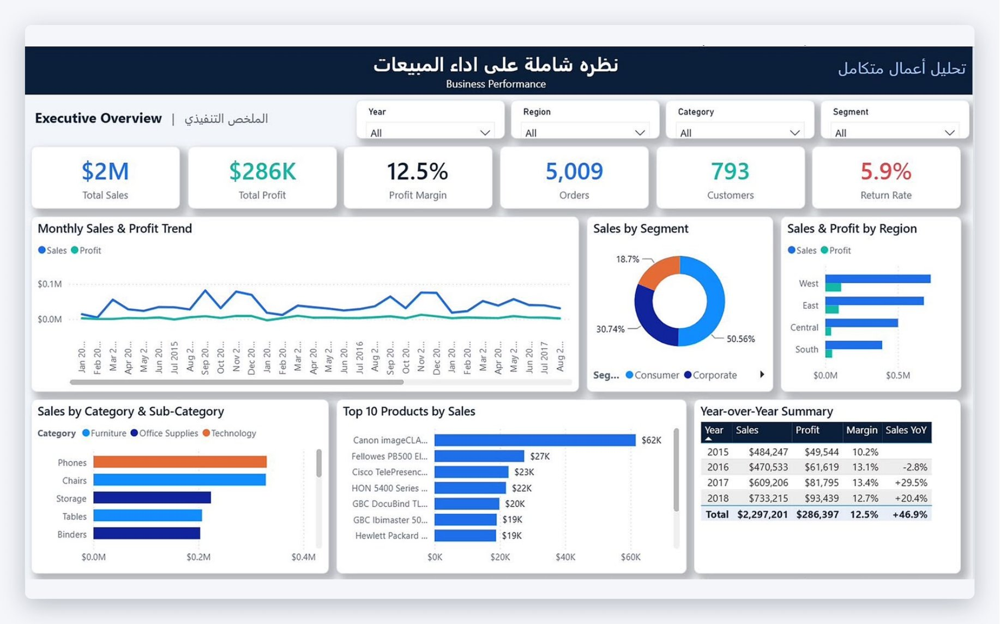
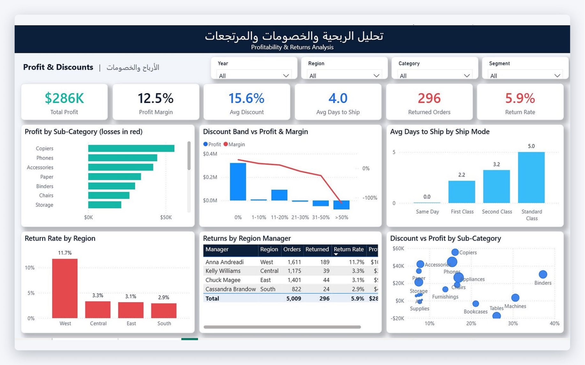
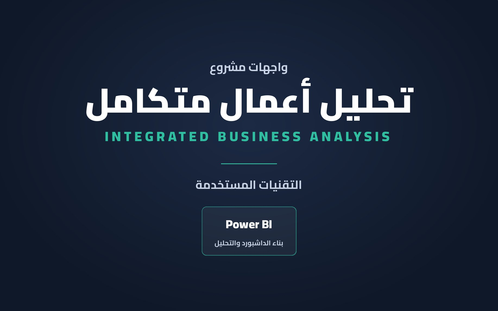

<h1 align="center">Integrated Business Analysis</h1>

<p align="center">
  A two-page Power BI report on Superstore sales, profit, discounts and returns across four U.S. regions (2015–2018).
</p>

<p align="center">
  
  
  
  
</p>

<p align="center">
  
</p>

<table>
  <tr>
    <td width="50%"></td>
    <td width="50%"></td>
  </tr>
  <tr>
    <td align="center"><b>Profit &amp; Discounts</b></td>
    <td align="center"><b>Cover</b></td>
  </tr>
</table>

All pages are collected in [`docs/Business_Analysis_Screens.pdf`](docs/Business_Analysis_Screens.pdf).

## Objectives

- Give a one-page view of business performance: sales, profit, margin, orders, customers and returns.
- Follow monthly sales and profit and compare each year with the previous one.
- Find which categories, sub-categories and products drive sales, and which ones lose money.
- Measure how discount levels affect profit and margin.
- Compare shipping time by ship mode and return rate by region and region manager.

## Dataset

`data/Superstore_Clean.xlsx` — the Superstore sample dataset after cleaning.

| Sheet | Rows | Contents |
| --- | ---: | --- |
| Superstore | 9,994 | One row per order line: order and ship dates, ship mode, customer, segment, city, state, region, product, category, sub-category, sales, quantity, discount, profit |
| Data Quality | — | Checks run on the clean data (blank cells, duplicates, invalid numbers and dates) |

Columns added during cleaning: `order_year`, `order_month`, `days_to_ship`, `discount_band`, `is_returned` and `region_manager`. The data quality sheet shows 0 blank cells, 0 duplicate records and 0 invalid values. A `Date` table (Year / Quarter / Month) is linked to the order date for the trends and year-over-year measures.

## Report pages

| Page | Focus |
| --- | --- |
| **Executive Overview** | KPI cards, monthly sales and profit trend, sales by segment, sales and profit by region, sales by category and sub-category, top 10 products, year-over-year summary. Filters: year, region, category, segment |
| **Profit & Discounts** | Profit by sub-category (losses in red), discount band vs. profit and margin, average days to ship by ship mode, return rate by region, returns by region manager, discount vs. profit by sub-category |

## Key measures

The semantic model contains 16 DAX measures; the full list is in [`dax/DAX-measures.dax`](dax/DAX-measures.dax).

| Group | Measures |
| --- | --- |
| Core | Total Sales, Total Profit, Profit Margin %, Total Orders, Total Customers, Total Quantity |
| Discounts &amp; returns | Avg Discount, Returned Orders, Return Rate % |
| Shipping | Avg Days to Ship |
| Time intelligence | Sales PY, Sales YoY %, Profit YoY % |
| Visual helpers | Top 10 Product Sales, Profit Gain, Profit Loss |

```dax
Profit Margin % =
    DIVIDE ( [Total Profit], [Total Sales] )

Sales YoY % =
    VAR PY = [Sales PY]
    RETURN IF ( NOT ISBLANK ( PY ), DIVIDE ( [Total Sales] - PY, PY ) )

Top 10 Product Sales =
    IF ( ISINSCOPE ( Orders[product_name] ),
        VAR R = RANKX ( ALLSELECTED ( Orders[product_name] ), [Total Sales], , DESC )
        RETURN IF ( R <= 10, [Total Sales] ) )
```

## Headline figures

| KPI | Value |
| --- | ---: |
| Total sales | $2,297,201 |
| Total profit | $286,397 |
| Profit margin | 12.5% |
| Orders | 5,009 |
| Customers | 793 |
| Return rate | 5.9% |

| Year | Sales | Profit | Margin | Sales YoY |
| --- | ---: | ---: | ---: | ---: |
| 2015 | $484,247 | $49,544 | 10.2% | |
| 2016 | $470,533 | $61,619 | 13.1% | −2.8% |
| 2017 | $609,206 | $81,795 | 13.4% | +29.5% |
| 2018 | $733,215 | $93,439 | 12.7% | +20.4% |

Orders with no discount earn a 29.5% margin, while every band above 20% discount loses money — orders discounted over 50% have a margin of −119%. Tables, Bookcases and Supplies are the only sub-categories with a total loss.

## Tools

- **Power BI Desktop** — report, semantic model and custom theme
- **DAX** — measures and time intelligence
- **Power Query (M)** — loading the clean workbook through a `FilePath` parameter
- **Excel** — data cleaning and quality checks

## Project structure

```
Integrated-Business-Analysis/
├── dashboard/
│   ├── Superstore_Dashboard.pbip              # open this in Power BI Desktop
│   ├── Superstore_Dashboard.Report/           # report pages and visuals
│   ├── Superstore_Dashboard.SemanticModel/    # data model, Power Query, DAX
│   └── Superstore_Theme.json                  # Power BI theme
├── dax/
│   └── DAX-measures.dax
├── data/
│   └── Superstore_Clean.xlsx
├── screenshots/                               # images used in this README
├── docs/
│   └── Business_Analysis_Screens.pdf
├── README.md
└── README_AR.md
```

## How to open

1. Clone the repository or download it as a ZIP and extract it (do not open files from inside the ZIP).
2. Open `dashboard/Superstore_Dashboard.pbip` in a recent version of Power BI Desktop.
3. Click **Home → Refresh**. The data is embedded in the model, so the report works without moving any file.
4. To read from your own copy of the workbook, set the `FilePath` parameter in **Transform data → Edit parameters** to the location of `data/Superstore_Clean.xlsx`, then refresh.
5. Optional: **View → Themes → Browse for themes** and choose `dashboard/Superstore_Theme.json`.

If Power BI shows a privacy-levels prompt, set **File → Options and settings → Options → Privacy → Ignore the Privacy Levels** and refresh again. To keep a single file, use **File → Save as → Power BI file (.pbix)**.

## نبذة بالعربي

لوحة Power BI من صفحتين لتحليل أداء متجر Superstore (2015–2018): المبيعات والأرباح وهامش الربح، أداء الفئات والمنتجات والمناطق، أثر الخصومات على الربحية، وأيام الشحن ونسب المرتجعات. التفاصيل الكاملة في [README_AR.md](README_AR.md).

---

<p align="center"><b>Author:</b> Fay Naif · <a href="https://github.com/fay-naif">GitHub</a> · <a href="https://www.linkedin.com/in/fay-naif-4295663b7">LinkedIn</a></p>
