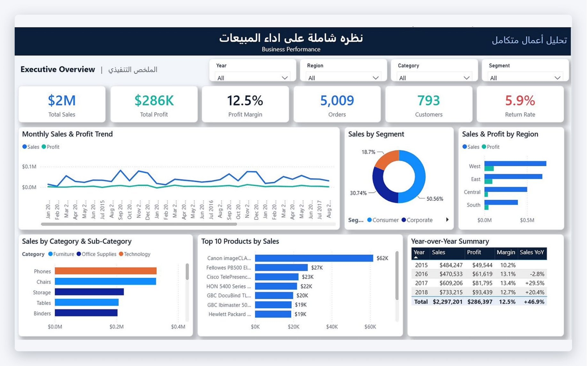

# تحليل أعمال متكامل

لوحة Power BI من صفحتين لتحليل بيانات متجر Superstore في أربع مناطق بالولايات المتحدة (2015–2018).

  

## الأهداف

- عرض أداء الأعمال في صفحة واحدة: المبيعات، الربح، هامش الربح، الطلبات، العملاء، والمرتجعات.
- متابعة المبيعات والأرباح شهرياً ومقارنة كل سنة بالسنة اللي قبلها.
- معرفة الفئات والفئات الفرعية والمنتجات اللي تقود المبيعات، واللي تسبب خسائر.
- قياس أثر مستويات الخصم على الربح والهامش.
- مقارنة أيام الشحن حسب طريقة الشحن، ونسبة المرتجعات حسب المنطقة ومدير المنطقة.

## البيانات

`data/Superstore_Clean.xlsx` — بيانات Superstore بعد التنظيف: 9,994 سطر طلب و26 عمود، مع ورقة لفحص جودة البيانات (0 خلايا فارغة، 0 تكرار، 0 قيم غير صالحة).

الأعمدة المضافة أثناء التنظيف: `order_year`، `order_month`، `days_to_ship`، `discount_band`، `is_returned`، `region_manager`. وجدول `Date` (سنة / ربع / شهر) مربوط بتاريخ الطلب.

## صفحات التقرير

| الصفحة | المحتوى |
| --- | --- |
| **نظرة شاملة على أداء المبيعات** | بطاقات المؤشرات، اتجاه المبيعات والأرباح الشهري، المبيعات حسب الشريحة، المبيعات والأرباح حسب المنطقة، المبيعات حسب الفئة والفئة الفرعية، أعلى 10 منتجات، ملخص سنوي مع نمو المبيعات. فلاتر: السنة، المنطقة، الفئة، الشريحة |
| **تحليل الربحية والخصومات والمرتجعات** | الربح حسب الفئة الفرعية (الخسائر بالأحمر)، شرائح الخصم مقابل الربح والهامش، متوسط أيام الشحن حسب طريقة الشحن، نسبة المرتجعات حسب المنطقة، المرتجعات حسب مدير المنطقة، الخصم مقابل الربح |

## أهم الأرقام

| المؤشر | القيمة |
| --- | ---: |
| إجمالي المبيعات | $2,297,201 |
| إجمالي الربح | $286,397 |
| هامش الربح | 12.5% |
| الطلبات | 5,009 |
| العملاء | 793 |
| نسبة المرتجعات | 5.9% |

الطلبات بدون خصم هامشها 29.5%، وكل شريحة خصم فوق 20% تخسر — والطلبات اللي خصمها فوق 50% هامشها −119%. و Tables و Bookcases و Supplies هي الفئات الفرعية الوحيدة اللي إجمالي ربحها خسارة.

## طريقة الفتح

1. نزّلي المستودع كـ ZIP وفكّي الضغط (لا تفتحين الملفات من داخل الـ ZIP).
2. افتحي `dashboard/Superstore_Dashboard.pbip` بنسخة حديثة من Power BI Desktop.
3. اضغطي **Home → Refresh**. البيانات مدمجة داخل النموذج فالتقرير يشتغل بدون نقل أي ملف.
4. لو تبين يقرأ من ملف الإكسل مباشرة: **Transform data → Edit parameters → FilePath** وحطي مسار `data/Superstore_Clean.xlsx` ثم Refresh.
5. اختياري: **View → Themes → Browse for themes** واختاري `dashboard/Superstore_Theme.json`.

## الأدوات

Power BI Desktop · DAX · Power Query · Excel

---

**إعداد:** في نايف · [GitHub](https://github.com/fay-naif) · [LinkedIn](https://www.linkedin.com/in/fay-naif-4295663b7)

